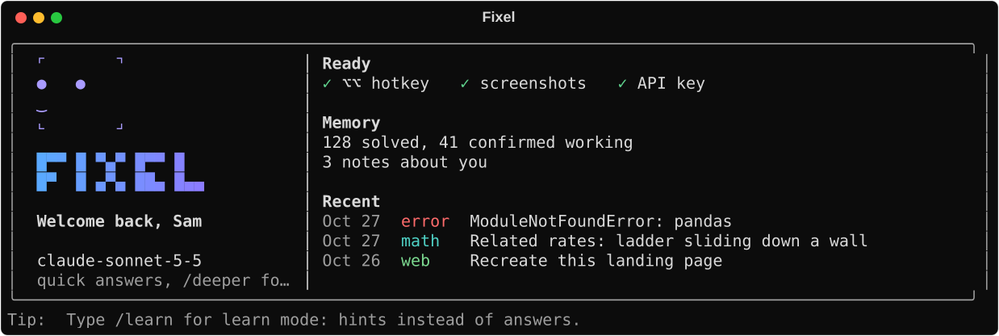
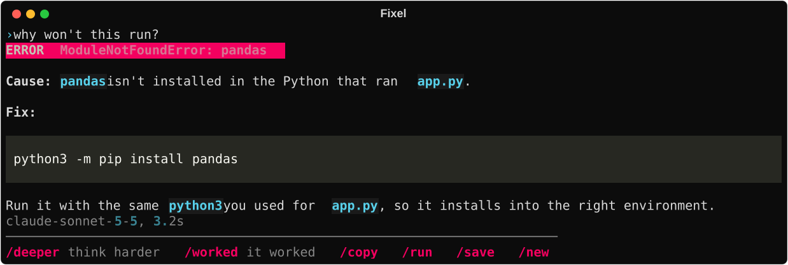
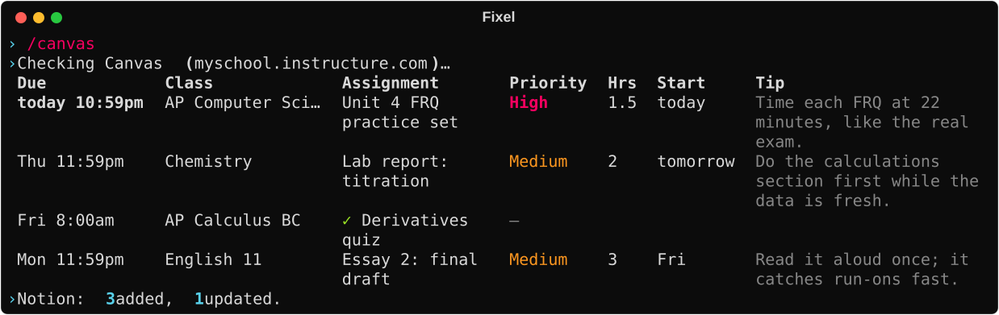

<div align="center">

# Fixel

**Screenshot anything you're stuck on. Get unstuck.**

Double-tap **Right Option ⌥**, drag over an error, a math problem, an email or a webpage,<br>
and an AI answers in your terminal: the fix, the steps, the draft, or the code.

[](https://github.com/Kiddo4993/Dylan-s-Personal-AI/actions/workflows/tests.yml)


[](LICENSE)



</div>

## Why Fixel

You don't copy and paste anything. Screenshot the problem, and Fixel reads it, works out what kind of problem it is, and answers in the format that fits.

It remembers what worked. When something you've solved before shows up again, Fixel hands the AI the fix that worked last time. Type `/worked` to tell it which fixes to trust.

It runs on your own Claude, Gemini or OpenAI key, kept in the macOS Keychain. There's no account, no server and no subscription.

It also has a learn mode that gives hints instead of answers, a built-in IDE for Python, Java, JavaScript and C++, and Canvas homework planning that syncs to Notion.

<div align="center"></div>

## What it answers

| You screenshot… | You get… |
|---|---|
| an error, stack trace, or broken code | the cause, plus the fix as a paste-ready command or diff |
| a math or homework problem | numbered steps and a final `Answer:` |
| an email, doc, or spreadsheet | a short summary plus a ready-to-use draft or formula |
| a confusing app screen | exact click-by-click steps |
| a webpage or design | its fonts, colours, layout and likely libraries, plus one HTML file that recreates it (⌃P opens it live) |

**What sets it apart**

- **Gets smarter with use:** Fixel reads each screenshot on your Mac, finds similar problems you've solved before, and hands those fixes to the AI. Type `/worked` when a fix works so Fixel prefers it next time, and use `/remember <fact>` to teach it about you (your classes, tools, setup).
- **One-step actions:** `/copy` copies the fix, `/run` runs the suggested command (only after you type `y`), `/save` saves a Markdown note. Type `/` to see every command.
- **Stack shots:** double-tap again before asking to add more screenshots (error + code + config) to one question.
- **Learn mode:** `/learn` switches to hints and guiding questions instead of answers; `/answer` reveals the full solution.

**Meet Pix.** Fixel's mascot is a little face made from screenshot-selection corners. It focuses in when Fixel starts, blinks and glances around while Fixel waits for the AI (*Reading your screenshot… 4s*), cheers when you type `/worked`, and frowns at errors. Set `animations = false` in `~/.fixel/config.toml` to keep it still.

## Install

You need macOS and Python 3.11 or newer (`brew install python@3.12`).

```bash
git clone https://github.com/Kiddo4993/Dylan-s-Personal-AI.git fixel && cd fixel
/opt/homebrew/bin/python3.12 -m venv .venv
.venv/bin/pip install -e '.[dev]'
ln -sf "$PWD/.venv/bin/fixel" /opt/homebrew/bin/fixel   # makes `fixel` work everywhere
```

## Set up (once)

Run this **in Terminal.app**, because macOS grants permissions to the app Fixel runs inside:

```bash
fixel setup
```

It will:
1. Ask for your **Anthropic API key** ([console.anthropic.com](https://console.anthropic.com/settings/keys)) and, optionally, a **Gemini key** ([aistudio.google.com](https://aistudio.google.com/apikey)) or **OpenAI key** ([platform.openai.com](https://platform.openai.com/api-keys)). Keys go into the macOS Keychain, never into a file.
2. Check that the key works and the model exists.
3. Open System Settings for **Input Monitoring** (the hotkey) and **Screen Recording** (screenshots). Switch Terminal on in both, then quit and reopen Terminal.

## Use

```bash
fixel           # opens Fixel in its own Terminal window
fixel --here    # runs in the current terminal instead
```

| Do this | To |
|---|---|
| ⌥⌥ (Right Option twice) | screenshot a region into the tray |
| Enter | ask (type a question first, or just press Enter) |
| `/` | see every command in a menu |
| `/deeper` | re-answer the last question with deep thinking |
| `/copy` · `/run` · `/save` | copy the fix · run its command (asks first) · save a note |
| `/worked` | mark a fix as proven, so Fixel prefers it next time |
| `/learn [on\|off]` · `/answer` | learn mode: hints instead of answers · show the full solution |
| `/follow` | add the tray to this case instead of starting a new one |
| `/remember <fact>` · `/memory` · `/forget <n>` | teach Fixel about you · list · remove |
| `/cases <words>` · `/open [n]` | search past cases · show one |
| `/play` | open the answer's code in the playground |
| `/canvas` · `/canvas setup` · `/canvas notion` | your Canvas assignments with AI priority, hours, start-by and a tip · connect Canvas · add a Notion database (see Canvas) |
| `/ide [language]` · `/ide web` · `/code` | the IDE in its own Terminal window · in the browser · in this window (see Playground) |
| `/new` · `/model sonnet\|opus\|gemini\|gpt` · `/api [provider] [key]` · `/help` · `/exit` | new case · switch model · set an API key · help · close Fixel |
| Ctrl+C | stop an answer that's streaming |

Prefer keys? Every one-step command also has a Ctrl shortcut (Ctrl+T `/deeper`, Ctrl+G `/worked`, Ctrl+Y `/copy`, Ctrl+R `/run`, Ctrl+S `/save`, Ctrl+N `/new`, Ctrl+F `/follow`, Ctrl+L `/learn`, Ctrl+O `/open`, Ctrl+P `/play`), listed at the bottom of `/help`.
`/instruction` lists every command and key in one place, including the terminal IDE's.

## Playground

- **`/ide [python|java|js|cpp]`** opens the terminal IDE in **its own Terminal window**, so Fixel stays free in yours. Press **⌃A** there and your code and its output land in Fixel's tray, and Fixel's window comes to the front so you can ask. The IDE stays open with your code; **Esc** closes the window. Outside Terminal.app (or without permission to control it), it opens in Fixel's window instead.
- **`/ide here [language]`** (or `/code`) opens the same IDE inside Fixel's own window.
- **The terminal IDE has:**
  - a file sidebar (**F4**), and line/column plus a modified marker in the status bar
  - **⌃Space** completion and auto-indent (**Shift+Tab** dedents)
  - **⌃F** find and **⌃G** go to line
  - **F5** run, **F3** input (stdin), **F2** next language
  - **⌃A** to ask Fixel about the code and its output
- **`/ide web [language]`** (or `/web`) opens the IDE in your browser, using the VS Code editor: live HTML preview, a Run button for the same four languages, and **Ask Fixel**. `/ide html` always goes here, since only the browser can preview HTML.
- **`/play`** (Ctrl+P) opens an answer's code: HTML in the browser, everything else in `/code`. Nothing runs until you press Run.
- Code runs on your Mac with your permissions (it's a scratchpad, not a sandbox). Runs stop after `playground_timeout` seconds (default 10). Your scratch code lives in `~/.fixel/playground/`.

## Canvas

<div align="center"></div>

`/canvas` lists what's due in the next `canvas_days` days (default 14), soonest first. Your current AI model adds a **priority**, an **hours** estimate, a **start-by** date and one **tip** to each new assignment, and it can keep a Notion database in sync. It runs on your own tokens: nothing goes through anyone else's server.

1. **`/canvas setup`** asks for one of these:
   - **An access token (best).** In Canvas: Account → Settings → **+ New Access Token**. You'll also type your school's Canvas address, e.g. `myschool.instructure.com`.
   - **Your calendar feed (fallback).** If your school hides the token button: Calendar → **Calendar Feed**, then copy the link. The feed can't tell Fixel what you've handed in.
2. **`/canvas notion`** (optional): make an integration at [notion.so/my-integrations](https://www.notion.so/my-integrations) and copy its secret. Then in Notion, open the page that should hold the database, choose ••• → Connections and add your integration, and paste the page's link. Fixel creates a **Canvas** database there.
3. **`/canvas`** syncs. Re-syncing is safe:
   - Canvas facts (title, due date, link, points, submitted) follow Canvas.
   - The AI fields are written once, so your edits stick.
   - **Status** is set when a row is created and never touched again.
   - A row you delete stays deleted.

`/canvas forget` removes both tokens from the Keychain. `/api canvas` and `/api notion` also open the setup steps. Tokens and the feed link are secrets: they live only in the macOS Keychain (or the `CANVAS_TOKEN` and `NOTION_TOKEN` environment variables), never in a file. `~/.fixel/canvas.json` keeps only your school's address, the database id, and the AI plans.

## Customize

- `~/.fixel/config.toml` sets the default model, model IDs, the backup Gemini models used when Google is busy or slow (`gemini_fallbacks`, `slow_model_seconds`), the double-tap speed, the notes folder, and how closely a past problem must match before Fixel reuses it (`recall_threshold`).
- `fixel/prompts.py` holds Fixel's personality and answer formats. Edit it to change how Fixel talks.

## Privacy & cost

Screenshots go only to the model provider you've selected (Anthropic, Google, or OpenAI). `/canvas` sends that same provider your assignment titles, classes, due dates and points (never your token), and sends Notion only the rows it writes. The case file, notes, and screenshots stay in `~/.fixel` and `~/Fixel Notes`. Claude bills per use, typically a fraction of a cent to a few cents per question; Opus costs more than Sonnet. Gemini has a free tier with rate limits.

## Develop

```bash
.venv/bin/pytest -q                     # the full suite; no network, no API keys needed
.venv/bin/python scripts/screenshots.py # redraw the README's screenshots from Fixel's real rendering code
```

Contributions are welcome. [CONTRIBUTING.md](CONTRIBUTING.md) covers the house rules (one command registry, fakes instead of the network, plain-English messages). If Fixel helps you, a ⭐ helps other people find it.

## License

MIT. See [LICENSE](LICENSE).
